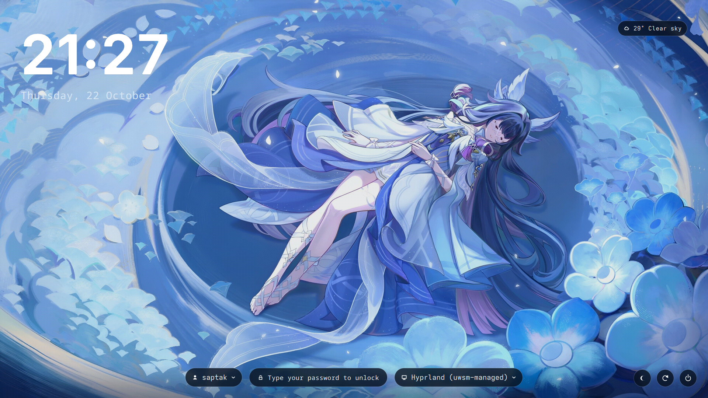
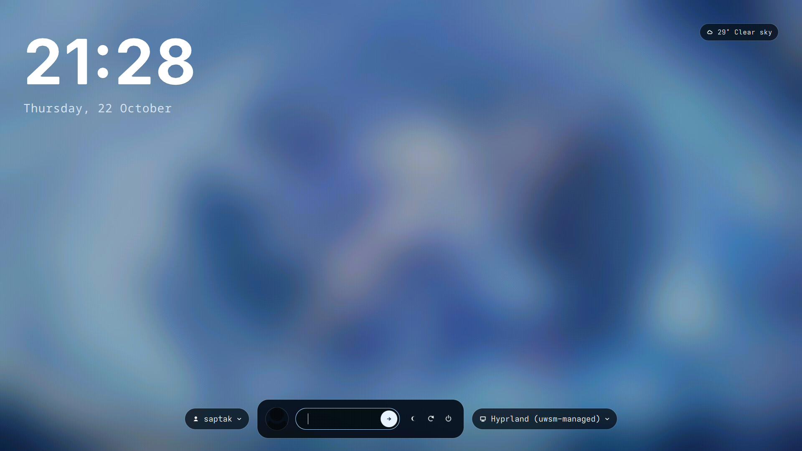

# AnimeUnlock

**A frosted-glass greeter for SDDM.** A profile selector on the left, a session selector on the right, and a password bar that rises out of a blurred wallpaper the moment you start typing.

[](https://github.com/sddm/sddm) [](https://qt.io) [](https://www.gnu.org/licenses/gpl-3.0.html) [](https://github.com/tiraq-official/AnimeUnlock/commits)

[Screens](#screens) · [Highlights](#highlights) · [Install](#install) · [Configure](#configure) · [Credits](#credits)

## Screens

| Idle | Unlocking |
| :-: | :-: |
|  |  |

## Highlights

**Two selectors, where you wanted them**
The account picker sits to the left of the unlock pill, the desktop-session picker to its right — in both the idle and the unlocking state.

**It blurs as you type**
Start typing, or click the pill, and the wallpaper cross-fades to a blurred copy while the password bar rises in its place. `Esc` on an empty field takes you back.

**Glass, not a flat box**
Every pill samples the wallpaper behind it, blurs it and clips it to its rounded shape. Turn it off with `PillFrost` if you'd rather have plain fills.

## Install

```bash
git clone https://github.com/tiraq-official/AnimeUnlock.git
cd AnimeUnlock && bash install.sh
```

It copies the theme to `/usr/share/sddm/themes/AnimeUnlock` and points SDDM at it. Then log out, or `sudo systemctl restart sddm`.

Preview it without logging out:

```bash
sddm-greeter --test-mode --theme /usr/share/sddm/themes/AnimeUnlock
```

## Configure

Everything lives in `theme.conf`.

| Key | |
| --- | --- |
| `background`, `backgroundBlur` | the two wallpapers; after swapping one, run `python3 make_blur.py` |
| `AvatarImage` | the round avatar — empty uses the account's own picture, or give a path |
| `PromptText` · `WeatherText` · `ShowWeather` | the two chips |
| `PillFrost`, `PillBlurRadius` | the frosted glass |
| `AlwaysShowPowerButtons` | keep suspend / restart / power visible in `--test-mode` |
| `DimBackground`, `BlurDuration` | dimming and cross-fade |

## Credits

Accounts and sessions come straight from SDDM, so the selectors always match the machine. The icons are drawn on a Canvas, and the blur ships for both Qt 5 and Qt 6 and picks whichever the greeter can load — no icon fonts, no extra assets.

GPL-3.0-or-later.
